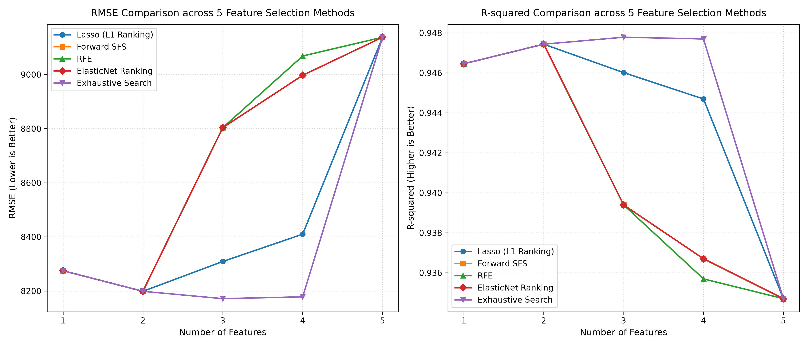

# 50 Startups: 多元線性迴歸與特徵選取探索儀 (AIoT HW2)
> **AIoT / 數位積體電路 (DIC) 專題作業 II：多元線性迴歸模型精簡性、多重共線性與特徵選取實證研究**  
> 遵循 **CRISP-DM** (Cross-Industry Standard Process for Data Mining) 標準流程，整合 Scikit-learn、Statsmodels 與純前端互動式儀表板。

---

## 🌐 線上展示與展示平台 (Live Demo)

🐙 **GitHub 專案儲存庫**：**[https://github.com/JasonWhite1012/AIot_DIC2](https://github.com/JasonWhite1012/AIot_DIC2)**  
🔗 **即時線上展示 (Live Demo)**：**[https://jasonwhite1012.github.io/AIot_DIC2/](https://jasonwhite1012.github.io/AIot_DIC2/)**

> 💡 **免伺服器直接運行**：本專案採用靜態數據註冊架構，GitHub Pages 可直接點擊使用完整 5 大演算法切換、特徵數量選擇、即時獲利預測計算機與統計推論檢定表。

---

## 📋 作業繳交資訊 (Student Metadata)
- **課程名稱**：人工智慧物聯網 (AIoT) / 數位積體電路 (DIC)
- **作業項目**：Homework 2 - Multiple Linear Regression & Feature Selection
- **學生姓名**：Jason White
- **GitHub 帳號**：[JasonWhite1012](https://github.com/JasonWhite1012)
- **GitHub 專案**：[https://github.com/JasonWhite1012/AIot_DIC2](https://github.com/JasonWhite1012/AIot_DIC2)
- **Live Demo 網址**：[https://jasonwhite1012.github.io/AIot_DIC2/](https://jasonwhite1012.github.io/AIot_DIC2/)

---

## 🌐 專案特色與系統架構

本專案針對經典的 **50 Startups** 創投數據集，探討企業在 **研發 (R&D Spend)**、**行銷 (Marketing Spend)**、**行政管理 (Administration)** 以及 **公司所在地 (State)** 的支出對 **年度淨獲利 (Profit)** 的非平庸影響。

專案全面實作並比較了 **5 種特徵篩選演算法** 在 $k=1 \dots 5$ 個預測變數下的泛化能力，具備以下核心功能：

1. **雙主題高科技介面 (Executive Dark / Light Theme)**：
   - 預設深色科技灰藍調（Cyber Slate / Neon Cyan & Emerald），並提供右上角一鍵平滑切換淺色模式（保存於 `localStorage`）。
2. **演算法即時切換**：
   - 支援 **Lasso (L1 排序)**、**Forward SFS (前向貪婪)**、**RFE (倒退消除)**、**ElasticNet (雙正則)**、**Exhaustive (最佳全子集)**，以及 **🌟 5 大演算法全面疊加對比**。
3. **互動式特徵階層步進器 ($k=1 \dots 5$)**：
   - 直觀標註 $k=2$ 為全局最優精簡點 (★ Sweet Spot)，$k=5$ 為過度配適警告 (⚠ Cliff)。
4. **即時動態迴歸方程式 (OLS Dynamic Equation)**：
   - 即時渲染帶有語法色彩之數學公式，可一鍵點擊複製至剪貼簿。
5. **統計推論與共線性檢驗表 (Inferential Statistics Table)**：
   - 完整展示 $\beta$ 係數、標準誤 (Std. Error)、$t$-Stat、$p$-Value (標記顯著性星號 `***`)、95% 信賴區間，以及 **VIF (變異數膨脹因子)** 共線性警示燈號。
6. **即時獲利預測計算機與瀑布貢獻圖 (Live Profit Predictor & Contribution Breakdown)**：
   - 包含數值微調與滑桿同步輸入，動態產出預測獲利，並以視覺化橫條圖分析基準截距與各項投入之貢獻度佔比。
7. **樣本外殘差與極端值診斷表 (Test Set Outliers Diagnostic)**：
   - 評估未參與訓練之 10 家測試集新創，依絕對殘差排序並提供吻合度評定。
8. **雙軌部署架構**：
   - **靜態模式**：透過 `model_data.js`，100% 支援 GitHub Pages 無伺服器環境直接執行。
   - **動態模式**：提供 Python Flask (`app.py`) REST API (`/api/models`, `/api/predict`, `/api/summary`)。

---

## 📊 核心實證結論 (Key Empirical Takeaways)



### 1. 奧坎剃刀原則：2 變數黃金精簡點 ($k=2$)
在所有 5 種特徵篩選方法中，模型均一致收斂於 **`['R&D Spend', 'Marketing Spend']`** 組合：
- **最小測試集 RMSE**：**`$8,198.80`**（全域最低預測誤差）。
- **最大決定係數 $R^2$**：**`0.9474`**（高達 94.74% 的新創獲利變異被有效解釋）。
- **研發主導地位**：單一變數 $k=1$ (R&D Spend) 即具備 $R^2 = 0.9465$ 的極高解釋力；加入行銷推廣支出能提供穩定且正向的互補預測效果。

### 2. 過度配適懸崖 ($k=5$)
當強行將所有可用欄位納入模型（加入 `Administration` 以及州別虛擬變數 `State_Florida`, `State_New York`）：
- **測試集 RMSE 劇烈反彈**：從 **`$8,198.80`** 飆升至 **`$9,137.99`**（誤差懲罰達 **+$939.19**，惡化幅度達 **11.5%**）。
- **自由度損耗與共線性**：多出的變數未達統計顯著性 ($p > 0.05$)，徒增雜訊與多重共線性風險。
- **結論**：實證嚴格證明了在機器學習中「特徵越多不代表越好」，精簡模型 (Parsimonious Model) 在未見樣本上具有更佳的泛化預測力。

---

## 🔬 5 種特徵選取演算法之完整表現矩陣

各演算法在測試集 ($N=10$, Random State = 0) 上的 RMSE 表現整理如下：

| 特徵選取演算法 | $k=1$ (RMSE) | $k=2$ (RMSE) | $k=3$ (RMSE) | $k=4$ (RMSE) | $k=5$ (RMSE) | 推薦最佳特徵子集 |
| :--- | :---: | :---: | :---: | :---: | :---: | :--- |
| **Lasso (L1 係數排序)** | $8,274.87 | **$8,198.80** | $8,309.06 | $8,409.92 | $9,137.99 | `['R&D Spend', 'Marketing Spend']` |
| **Forward SFS (前向逐步)** | $8,274.87 | **$8,198.80** | $8,803.78 | $8,997.20 | $9,137.99 | `['R&D Spend', 'Marketing Spend']` |
| **RFE (遞迴倒退消除)** | $8,274.87 | **$8,198.80** | $8,803.78 | $9,068.54 | $9,137.99 | `['R&D Spend', 'Marketing Spend']` |
| **ElasticNet (彈性網路)** | $8,274.87 | **$8,198.80** | $8,803.78 | $8,997.20 | $9,137.99 | `['R&D Spend', 'Marketing Spend']` |
| **Exhaustive (最佳全子集)** | $8,274.87 | $8,198.80 | **$8,171.65** | $8,178.37 | $9,137.99 | `['R&D Spend', 'Admin', 'State_FL']` |

> **註解**：在 Exhaustive 搜尋中，$k=3$ 挑選了特定隨機雜訊組合取得微幅數值優勢，但以統計顯著性與實務業務意涵審視，$k=2$ (R&D + Marketing) 依然具備最高的結構穩健性與可解釋性。

---

## 📂 專案目錄結構

```text
├── index.html                           # 核心主頁面 (支援 GitHub Pages 靜態直啟，含 Dark/Light 雙主題)
├── model_data.js                        # 純前端靜態資料註冊檔 (保證無後端時完整運算)
├── model_data.json                      # 完整模型矩陣 JSON (供 Flask API 與 Python 腳本調用)
├── app.py                               # Flask 伺服器與 REST API 路由
├── main.py                              # CRISP-DM 六大階段 Python 完整執行腳本
├── feature_progression_analysis.py      # k=1..5 特徵篩選漸進分析與作圖腳本
├── requirements.txt                     # Python 依賴清單
├── all_5_algorithms_comparison_plot.png # 5 種演算法全面比較折線圖
├── lasso_l1_ranking_plot.png            # Lasso 漸進圖
├── forward_sfs_plot.png                 # Forward SFS 漸進圖
├── rfe_plot.png                         # RFE 漸進圖
├── elasticnet_ranking_plot.png          # ElasticNet 漸進圖
├── exhaustive_search_plot.png           # 窮舉搜尋漸進圖
├── feature_selection_comparison.csv     # 演算法指標彙整 CSV
├── .github/
│   └── workflows/
│       └── deploy.yml                   # 自動化 GitHub Pages 部署腳本
└── README.md                            # 專案說明與作業繳交手冊
```

---

## 🚀 本地快速啟動方式 (How to Run Locally)

本專案支援兩種運行方式：

### 方式 A：直接使用瀏覽器開啟 (最推薦、最快速)
1. 將本專案下載或 Clone 至本地。
2. 直接點擊 **`index.html`**，以 Chrome、Edge 或 Safari 開啟即可瀏覽完整的互動功能！

### 方式 B：使用 Python Flask 運行全端伺服器
1. **建立並啟用虛擬環境 (建議)**：
   ```bash
   python -m venv venv
   # Windows:
   venv\Scripts\activate
   # macOS/Linux:
   source venv/bin/activate
   ```

2. **安裝所需依賴**：
   ```bash
   pip install -r requirements.txt
   ```

3. **啟動 Flask 應用程式**：
   ```bash
   python app.py
   ```
   終端機將提示服務啟動，瀏覽器存取：**`http://localhost:5000`**。

4. **重新產生分析數據與圖表 (選用)**：
   ```bash
   python main.py
   python feature_progression_analysis.py
   ```

---

## ☁️ 如何上傳並部署至 GitHub 與 GitHub Pages

請按照以下簡易步驟將作業上傳至您的個人 GitHub：

### 步驟 1：建立 GitHub 遠端儲存庫
1. 登入 [GitHub](https://github.com/)，點擊右上角 **New repository**。
2. 儲存庫名稱輸入 `AIoT_HW2_MultipleLR`（或自訂名稱）。
3. 設為 **Public**，不要勾選 "Initialize with README"（本專案已有完整檔案）。
4. 點擊 **Create repository**。

### 步驟 2：初始化本地 Git 並推播 (Push)
在專案根目錄開啟終端機 (PowerShell 或 Bash)，執行：
```bash
git init
git add .
git commit -m "feat: AIoT HW2 Multiple Linear Regression & Feature Selection Explorer"
git branch -M main
git remote add origin https://github.com/<您的GitHub帳號>/<您的儲存庫名稱>.git
git push -u origin main
```

### 步驟 3：啟用 GitHub Pages 免費靜態網站託管
1. 進入您剛建立的 GitHub 專案頁面，點選頂部選單的 **Settings**。
2. 在左側選單點選 **Pages**。
3. 在 **Build and deployment** > **Branch** 下方：
   - 分支選擇 **`main`**。
   - 資料夾選擇 **`/ (root)`**。
   - 點擊 **Save**。
4. 等待 1~2 分鐘後重新整理頁面，頂部即會顯示綠色打勾網址：  
   `https://<您的GitHub帳號>.github.io/<您的儲存庫名稱>/`。

---

## 🛠️ CRISP-DM 數據採掘方法論對照

| 階段 (Phase) | 執行內容與檔案 |
| :--- | :--- |
| **1. Business Understanding** | 明確新創獲利預測之商業目標，確立以統計顯著性及奧坎剃刀原則尋求最佳子集。 |
| **2. Data Understanding** | 探勘 50 筆新創數據分佈、相關性熱力圖，確認 R&D Spend 相關性最高 ($r=0.97$)。 |
| **3. Data Preparation** | 針對類別變數 `State` 進行 One-Hot 編碼（California 作為對照基準組）；嚴格 80/20 劃分。 |
| **4. Modeling** | 實作 LassoCV、RFECV、Sequential Forward Selection、ElasticNetCV 及 Exhaustive 窮舉。 |
| **5. Evaluation** | 嚴格比對 $k=1 \dots 5$ 之測試集 RMSE 與 $R^2$，檢定多重共線性 (VIF) 與極端殘差。 |
| **6. Deployment** | 交付純前端 GitHub Pages 互動平台與 Flask REST API，提供端到端即時推論。 |

---

## 📜 參考文獻與致謝
1. **數據集來源**：
   - Avik Jain, *100-Days-Of-ML-Code: 50_Startups Dataset*. [GitHub Raw Data Link](https://raw.githubusercontent.com/Avik-Jain/100-Days-Of-ML-Code/master/datasets/50_Startups.csv)
2. **統計介面設計參考**：
   - [StatsUnlock Multiple Linear Regression Calculator](https://statsunlock.com/multiple-linear-regression-calculator/)
3. **技術套件**：
   - [Scikit-learn](https://scikit-learn.org/)、[Statsmodels](https://www.statsmodels.org/)、[Chart.js](https://www.chartjs.org/)、[Flask](https://flask.palletsprojects.com/)
